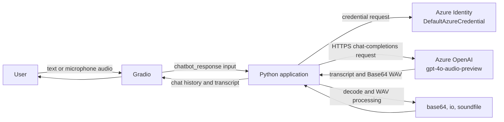
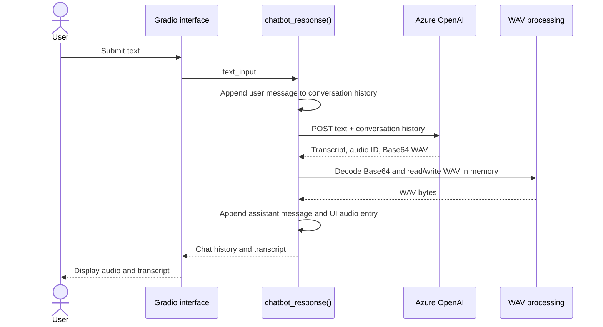
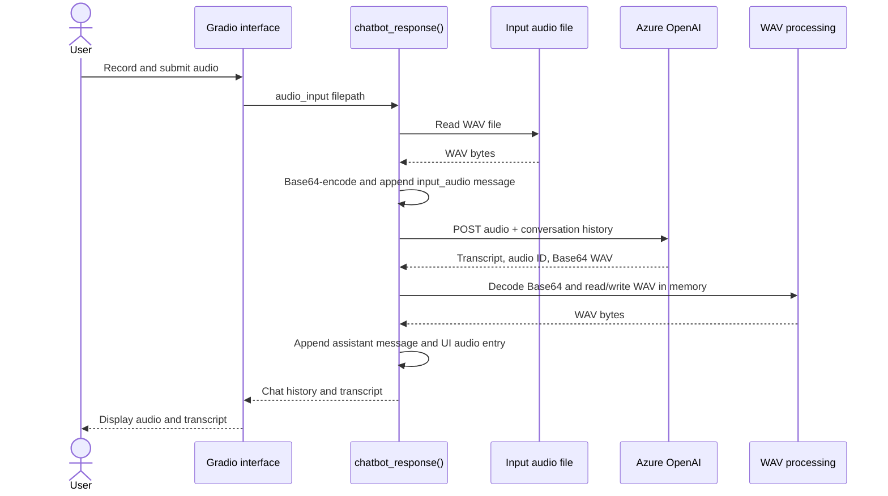

# Multimodal Audio/Text GPT Chatbot

A small Gradio application that accepts text or microphone audio, sends the input and conversation context to an Azure OpenAI audio deployment, and displays the returned audio and transcript.

## Requirements and setup

- Python with the packages in [`requirements.txt`](requirements.txt)
- An Azure OpenAI resource with the `gpt-4o-audio-preview` deployment (or a deployment name configured in the source)
- An Azure identity available to `DefaultAzureCredential` and authorized to call that resource

Install the listed packages:

```bash
python -m pip install -r requirements.txt
```

Set the endpoint in the environment or in a `.env` file in the working directory:

```text
AZURE_OPENAI_ENDPOINT=https://<your-resource>.openai.azure.com
```

Start the app from the repository directory:

```bash
python multimodal-audiotext-gptaudio.py
```

Gradio prints the local URL when the interface launches. The endpoint, deployment name, and API version are read or defined in `multimodal-audiotext-gptaudio.py`.

## How it works

The application is implemented in one Python module. At startup it loads `.env`, reads `AZURE_OPENAI_ENDPOINT`, obtains a token with Azure Identity, initializes two in-memory history lists, builds the Gradio interface, and launches it.

The interface has a text box and a microphone audio input. On submission, `chatbot_response()` selects the text path when text is provided; otherwise it handles a supplied audio filepath. Both paths send a chat-completions request with audio and text modalities to Azure OpenAI. The response transcript is returned to a textbox, and the Base64 WAV response is decoded and converted to an in-memory WAV for the chat display.

### Component view



### Text submission sequence



### Microphone submission sequence



## Current implementation notes

- The deployment name (`gpt-4o-audio-preview`), API version (`2025-01-01-preview`), response format (`wav`), and voice (`alloy`) are hard-coded in the Python module.
- Although startup obtains an Azure identity token, the request currently sets the `Authorization` header to the literal placeholder `******` instead of using that token. Azure requests are therefore likely to fail authentication until the header is corrected.
- Conversation and Gradio histories are module-level lists, not session-scoped. They persist only for the life of the process and are shared between users of the same running app.
- The request paths assume a successful API response; HTTP status and API errors are not handled. Only the most recent audio is playable in the chat history.
- The source is illustrative sample code, not production-ready software.

## Sample code disclaimer

> This Sample Code is provided for the purpose of illustration only and is not intended to be used in a production environment. THIS SAMPLE CODE AND ANY RELATED INFORMATION ARE PROVIDED "AS IS" WITHOUT WARRANTY OF ANY KIND, EITHER EXPRESSED OR IMPLIED, INCLUDING BUT NOT LIMITED TO THE IMPLIED WARRANTIES OF MERCHANTABILITY AND/OR FITNESS FOR A PARTICULAR PURPOSE. We grant You a nonexclusive, royalty-free right to use and modify the Sample Code and to reproduce and distribute the object code its authors,or anyone else involved in the creation, production, or delivery of the scripts be liable for any damages whatsoever (including, without limitation, damages for loss of business profits, business interruption, loss of business information, or other pecuniary loss) arising out of the use of or inability to use the sample scripts or documentation, even if its has been advised of the possibility of such damages
